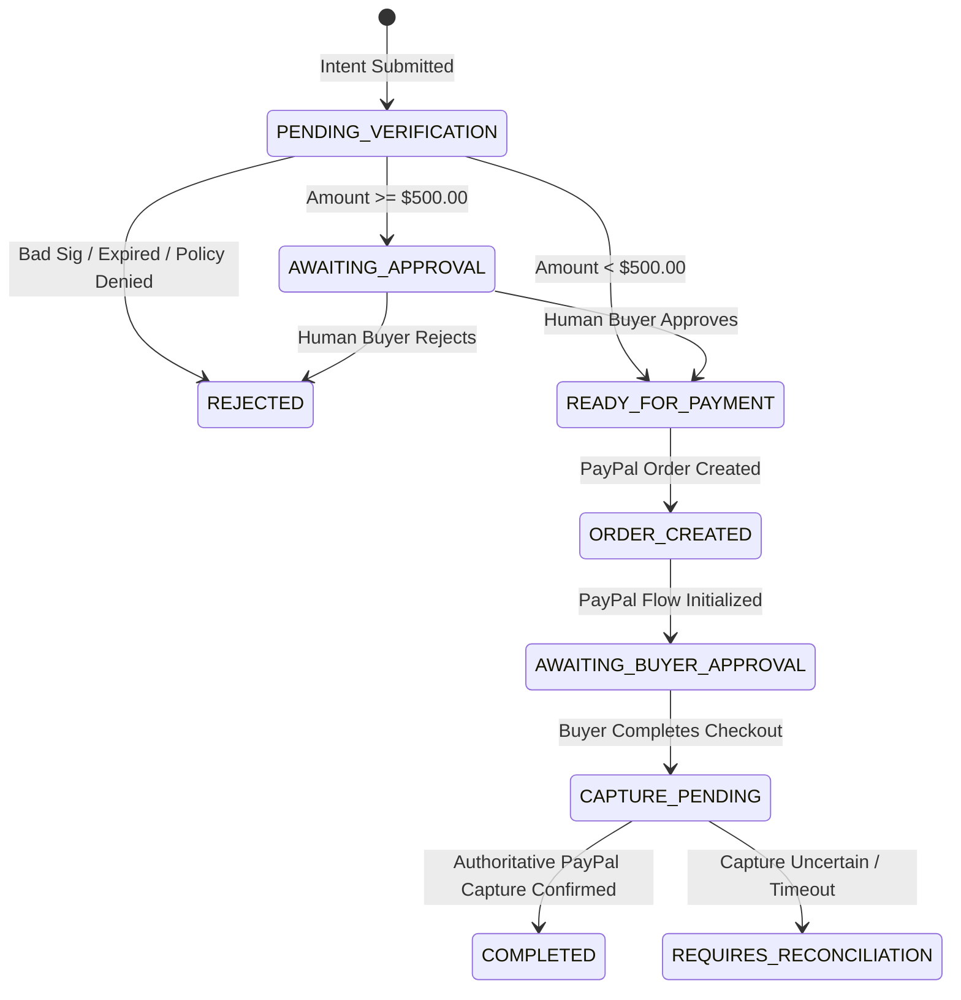

# System Architecture & Lifecycle

AgentShield is structured as a decoupled security proxy that protects financial payment rails from rogue or compromised AI agents.

---

## High-Level Architecture

```text
┌────────────────────────────────────────────────────────────────────────┐
│                          CLIENT / AGENT TIER                           │
│  [ Autonomous Buyer Agent ]             [ Autonomous Seller Agent ]    │
└─────────────────────────────────┬──────────────────────────────────────┘
                                  │ HTTPS (Signed Intent Payload)
                                  ▼
┌────────────────────────────────────────────────────────────────────────┐
│                        AGENTSHIELD PROXY GATEWAY                       │
│                                                                        │
│   1. Identity Verification Service                                     │
│      • Validates Ed25519 digital signature over canonical payload      │
│      • Verifies agent status (ACTIVE vs. SUSPENDED/REVOKED)            │
│      • Enforces Challenge-Response private-key ownership               │
│                                                                        │
│   2. Timing & Replay Guard                                             │
│      • Atomic one-time Nonce uniqueness check (Database constraint)    │
│      • Clock-skew tolerance check (<= 30s drift)                       │
│      • Maximum validity window boundary (<= 5 minutes)                 │
│                                                                        │
│   3. Deterministic Policy Engine                                       │
│      • Zero-float integer minor units enforcement (cents)              │
│      • Recipient allowlisting & self-payment loop prevention           │
│      • Per-transaction limit ($1,000.00 max)                           │
│      • Rolling 24-hour daily spend tracking ($2,500.00 max)            │
│      • Human-in-the-loop review threshold (>= $500.00)                 │
│      • Security risk flag blocking (e.g. PROMPT_INJECTION_SUSPECTED)   │
│                                                                        │
│   4. State Machine & Audit Service                                     │
│      • Linear transaction lifecycle tracking in PostgreSQL             │
│      • Tamper-evident AuditEvent event stream                          │
└───────────────────┬─────────────────────────────────┬──────────────────┘
                    │                                 │
     (Only if APPROVED)                               │ (State & Audit)
                    ▼                                 ▼
┌───────────────────────────────────┐  ┌─────────────────────────────────┐
│     PAYPAL ADAPTER (PART 2)       │  │      POSTGRESQL PERSISTENCE     │
│  • PayPal OAuth 2.0 Client        │  │  • agents                       │
│  • Orders API v2 Order Creation   │  │  • payment_intents              │
│  • Server-Side Capture            │  │  • audit_events                 │
│  • Webhook Signature Verification │  │  • webhook_events               │
└─────────────────┬─────────────────┘  └─────────────────────────────────┘
                  │
                  ▼
┌───────────────────────────────────┐
│       PAYPAL SANDBOX RAILS        │
└───────────────────────────────────┘
```

---

## Core Security Boundaries

1. **Separation of Policy and Payment Rails:**
   The policy engine never communicates directly with PayPal. It only produces a signed, auditable `APPROVED` decision. PayPal order creation is an downstream step that can only be invoked for intents with status `READY_FOR_PAYMENT`.

2. **Zero Trust in AI Generation:**
   AI agents can generate text, formulate plans, and negotiate terms. However, the decision of whether a transaction is permitted is evaluated **100% deterministically by code**, never by an LLM prompt.

3. **Server-Side Secret Isolation:**
   PayPal client secrets, access tokens, and database credentials remain strictly within the server runtime. No client or AI agent ever receives API secrets.

---

## Transaction State Machine

Every payment intent progresses through strict, non-reversible states:



### State Definitions

| Status | Meaning |
| :--- | :--- |
| `PENDING_VERIFICATION` | The intent payload is undergoing cryptographic and policy checks. |
| `REJECTED` | The intent failed signature verification, expired, replayed a nonce, or violated policy limits. Terminal state. |
| `AWAITING_APPROVAL` | The transaction passed policy checks but exceeds the automated threshold ($500.00), requiring human approval. |
| `READY_FOR_PAYMENT` | All checks passed. The transaction is authorized for PayPal order creation. |
| `ORDER_CREATED` | A PayPal Orders v2 order was successfully created on the server. |
| `AWAITING_BUYER_APPROVAL` | Waiting for the human buyer to complete approval in the PayPal JS SDK modal. |
| `CAPTURE_PENDING` | Order approval received; server-side capture has been initiated. |
| `COMPLETED` | Authoritative capture confirmation received from PayPal. Payment finalized. |
| `REQUIRES_RECONCILIATION` | Capture returned an ambiguous state; requires webhook verification before releasing deliverables. |
